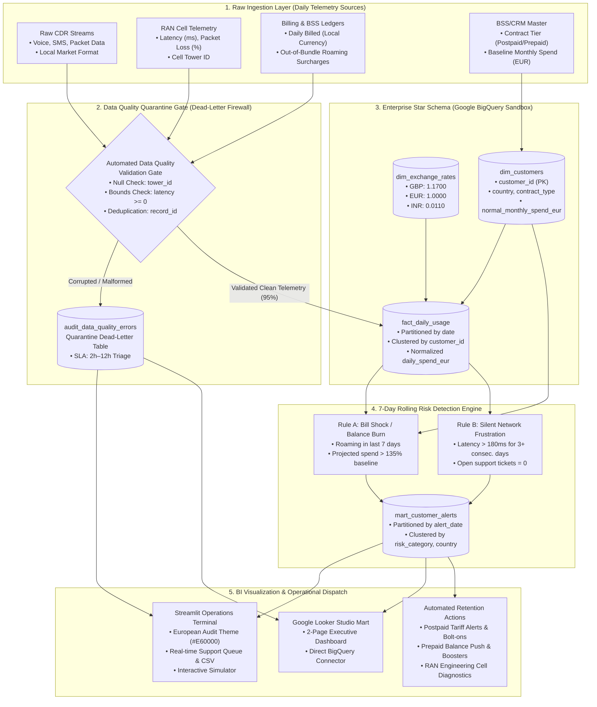
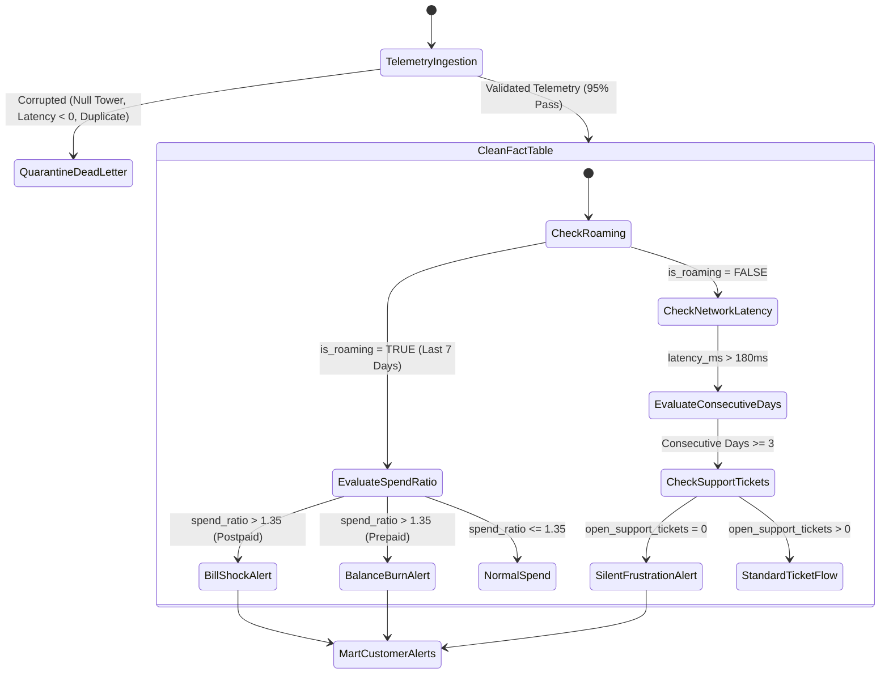
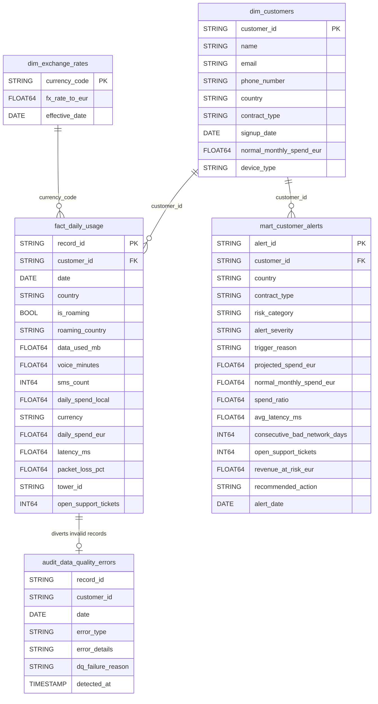

# TelecomGuard – Proactive Telco Risk & Retention Pipeline
**Vodafone Intelligent Solutions (VOIS) — Revenue Assurance, Churn Prevention & Data Governance**

[](https://www.python.org/)
[](https://cloud.google.com/bigquery)
[](https://streamlit.io/)
[](https://lookerstudio.google.com/)
[](LICENSE)

---

## 1. Executive Summary & Overview

**TelecomGuard** is an enterprise data engineering and retention intelligence pipeline engineered for **Vodafone Intelligent Solutions (VOIS)**. Operating across three primary multinational markets—**United Kingdom (UK)**, **Germany (DE)**, and **India (IN)**—TelecomGuard ingests high-velocity daily Call Detail Records (CDRs), radio access network (RAN) telemetry, customer care tickets, and billing ledgers to solve three critical telecom operational challenges:

1. **Bill Shock & Balance Burn Prevention**: Proactively detecting roaming subscribers projected to exceed 135% of their typical baseline monthly spend before invoice generation (Postpaid) or sudden credit depletion (Prepaid).
2. **Silent Network Frustration Detection**: Isolating subscribers enduring severe degraded network performance (ping latency > 180ms for 3+ consecutive calendar days) who have **zero open customer support tickets**—the single highest-risk cohort for unannounced churn.
3. **Data Quality Quarantine Gate**: Filtering and auditing malformed or corrupted raw telemetry (null cell towers, negative latency, duplicate records) in an isolated dead-letter partition before it contaminates the core analytics warehouse.

The entire cloud data warehouse architecture is built to run on the **Google BigQuery Sandbox ($0 tier)** using idempotent DDL transformations without incurring storage or compute billing.

---

## 2. End-to-End Enterprise Architecture



---

## 3. Multi-Country EUR FX Normalization Standard

To eliminate financial distortion across Vodafone operating entities, all financial telemetry and risk metrics are normalized to **EUR (€)** at ingestion time using deterministic exchange rate multipliers maintained in `dim_exchange_rates`.

$$\text{daily\_spend\_eur} = \text{daily\_spend\_local} \times \text{fx\_rate\_to\_eur}$$

| Operating Company (Market) | Local Currency | Pegged / Baseline FX Rate to EUR | Mathematical Implementation |
| :--- | :--- | :--- | :--- |
| **Vodafone UK (UK)** | `GBP` (£) | **`1.1700`** | `daily_spend_eur = daily_spend_local * 1.1700` |
| **Vodafone Germany (DE)** | `EUR` (€) | **`1.0000`** | `daily_spend_eur = daily_spend_local * 1.0000` |
| **Vodafone Idea (IN)** | `INR` (₹) | **`0.0110`** | `daily_spend_eur = daily_spend_local * 0.0110` |

### Key Benefits:
- **Unified Cross-Border Aggregation**: Enables executive leadership to compare revenue at risk across Vodafone UK, Vodafone Germany, and Vodafone Idea in a single standardized currency.
- **Consistent Alert Thresholds**: Enables standard percentage-based risk evaluation (`spend_ratio > 1.35`) independent of local currency inflation or magnitude differences.

---

## 4. Data Quality Quarantine Gate (Dead-Letter Firewall)

To ensure data integrity, the pipeline establishes an automated quarantine firewall during Step 1 of the ETL process. Raw records are inspected against three explicit data quality rules before any warehouse insertion:

```
                                  +-----------------------+
                                  |   raw_usage_logs      |
                                  +-----------------------+
                                              |
                                              v
                              +-------------------------------+
                              | Automated Data Quality Checks |
                              +-------------------------------+
                                 /                         \
           Fails any condition  /                           \ Passes all conditions
                               v                             v
               +---------------------------+     +--------------------+
               | audit_data_quality_errors |     |  fact_daily_usage  |
               | (Quarantined Dead-Letter) |     |  (Clean Warehouse) |
               +---------------------------+     +--------------------+
```

### Quarantine Criteria

| Failure Condition | Check Logic | Operational Impact / Root Cause | Error Classification |
| :--- | :--- | :--- | :--- |
| **Missing Cell Tower** | `tower_id IS NULL OR TRIM(tower_id) = ''` | Telemetry packet loss; cellular sector ID unmapped; blind spot for RAN engineers. | `NULL_TOWER_ID` |
| **Negative Latency** | `latency_ms < 0` | Microsecond clock drift between base station and client handset; corrupted ping sensor. | `NEGATIVE_LATENCY` |
| **Duplicate CDR Record** | `ROW_NUMBER() OVER (PARTITION BY record_id ORDER BY date DESC) > 1` | Re-transmitted packet, pipeline double-ingestion; would cause double-billing. | `DUPLICATE_RECORD_ID` |

### Audit Metadata Recorded:
- `record_id`, `customer_id`, `date`, `country`, `tower_id`, `latency_ms`
- `dq_failure_reason`: Semicolon-delimited failure tags (e.g., `NULL_TOWER_ID; NEGATIVE_LATENCY`)
- `error_type`: Categorical failure classification (`NULL_TOWER_ID`, `NEGATIVE_LATENCY`, `DUPLICATE_RECORD_ID`, or `MULTIPLE_ERRORS`)
- `detected_at`: Audit timestamp for SLA tracking and engineer triage
- **Zero Production Contamination**: Quarantined records never enter `fact_daily_usage` or influence customer risk scores.

---

## 5. 7-Day Rolling Risk Detection Logic

The risk engine computes alerts by analyzing customer usage over a **trailing 7-day rolling window** (`RANGE BETWEEN 6 PRECEDING AND CURRENT ROW`) using BigQuery Standard SQL window functions.



### Rule A: Bill Shock & Balance Burn
Identifies customers traveling abroad who incur excessive tariffs that will drastically outstrip their baseline expectations:
- **Target Population**: Roamed internationally in the last 7 days (`is_roaming = TRUE`).
- **Spend Extrapolation**:
  $$\text{projected\_spend\_eur} = \left( \frac{\text{last\_7d\_spend\_eur}}{7} \right) \times 30$$
- **Trigger Condition**:
  $$\text{spend\_ratio} = \frac{\text{projected\_spend\_eur}}{\text{normal\_monthly\_spend\_eur}} > 1.35$$
- **Contract Type Segmentation**:
  - **Postpaid &rarr; `Bill Shock Risk`**: High probability of invoice dispute, customer anger, and bad-debt write-offs.
  - **Prepaid &rarr; `Balance Burn Risk`**: High probability of balance exhaustion and SIM dormancy without recharge.
- **Severity Rating**:
  - `CRITICAL`: Projected spend > 200% of baseline (`spend_ratio > 2.00`).
  - `HIGH`: Projected spend between 135% and 200% of baseline (`1.35 < spend_ratio <= 2.00`).

### Rule B: Silent Network Frustration
Identifies subscribers suffering persistent Quality of Experience (QoE) degradation who do not reach out to customer care, making them prime candidates for unannounced competitor churn:
- **Degradation Condition**: Daily average latency > 180ms for **3 consecutive calendar days**:
  $$\text{latency\_ms}_T > 180 \quad\land\quad \text{latency\_ms}_{T-1} > 180 \quad\land\quad \text{latency\_ms}_{T-2} > 180$$
  $$\text{DATE\_DIFF}(T, T-1) = 1 \quad\land\quad \text{DATE\_DIFF}(T-1, T-2) = 1$$
- **Silent Trigger Condition**:
  $$\text{open\_support\_tickets} = 0$$
- **Severity Rating**:
  - `CRITICAL`: Sustained latency > 250ms.
  - `HIGH`: Sustained latency between 180ms and 250ms.

### 7-Day Alert Suppression / Cooldown Filter
To avoid spamming frontline retention agents and subscribers with duplicate alerts, the pipeline implements an alert suppression window:
$$\text{suppression\_window\_id} = \text{DIV}\left(\text{DATE\_DIFF}(\text{alert\_date}, \text{initial\_detection\_date}, \text{DAY}), 7\right)$$
Only the first occurrence within any rolling 7-day window per subscriber and alert type is dispatched to operations.

### Operational Intervention Matrix

| Risk Category | Contract Type | Trigger Condition | Recommended Operational Action | SLA Target |
| :--- | :--- | :--- | :--- | :--- |
| **Bill Shock** | Postpaid | Roaming 7d + spend > 135% | Send proactive SMS tariff alert; offer temporary roaming data pass or bolt-on before invoice closure. | < 4 hours |
| **Balance Burn** | Prepaid | Roaming 7d + spend > 135% | Send balance alert push notification; offer 25% recharge bonus or discounted 30-day recurring bundle. | < 30 minutes |
| **Silent Frustration** | Postpaid | Latency > 180ms (3d) + 0 tickets | VIP Network Care: Proactive outreach, dispatch RAN cell diagnostics, credit €10 loyalty goodwill voucher. | < 12 hours |
| **Silent Frustration** | Prepaid | Latency > 180ms (3d) + 0 tickets | Network Retention Care: Push OTA APN network reconfiguration profile; grant complimentary 5GB 3-day data booster. | < 6 hours |

---

## 6. BigQuery Sandbox ($0 Tier) Star Schema

The warehouse strictly complies with **Google BigQuery Sandbox ($0 No-Billing Free Tier)** specifications.

### Zero-Billing Architectural Principles
1. **Strict Idempotent DDL Only**: No DML statements (`INSERT`, `UPDATE`, `DELETE`, `MERGE`). Every transformation executes as:
   ```sql
   CREATE OR REPLACE TABLE `vois_telecomguard.<table>` AS SELECT ...
   ```
2. **Partitioning**:
   - `fact_daily_usage` is partitioned daily by `date` (`PARTITION BY date`).
   - `mart_customer_alerts` is partitioned daily by `alert_date` (`PARTITION BY alert_date`).
3. **Clustering**:
   - `fact_daily_usage` is clustered by `customer_id` (`CLUSTER BY customer_id`).
   - `mart_customer_alerts` is clustered by `risk_category, country` (`CLUSTER BY risk_category, country`).
4. **ANSI SQL Standard Window Functions**: Uses deterministic window frames (`RANGE BETWEEN 6 PRECEDING AND CURRENT ROW`, `LAG()`, `ROW_NUMBER()`).

### Entity Relationship Model



---

## 7. Executive Key Performance Indicators (KPIs)

Parity across BigQuery SQL queries, the Streamlit Operations Terminal, and Google Looker Studio is governed by strict mathematical KPI definitions:

| KPI Metric | Mathematical Formulation | Business Significance |
| :--- | :--- | :--- |
| **Total Revenue at Risk (€)** | $\sum_{i \in \text{Alerts}} \text{revenue\_at\_risk\_eur}_i$ | Total monetary exposure across high-risk accounts. |
| **Bill Shock Cases** | $\sum \mathbb{I}(\text{risk\_category} \in \{\text{'Bill Shock'}, \text{'Balance Burn'}\})$ | Accounts incurring catastrophic roaming tariff overages. |
| **Silent Frustration Cases** | $\sum \mathbb{I}(\text{risk\_category} = \text{'Silent Network Frustration'})$ | High-churn subscribers with unresolved network degradation. |
| **Data Quality Pass Rate (%)** | $\left( \frac{\text{Count}(\text{fact\_daily\_usage})}{\text{Count}(\text{fact\_daily\_usage}) + \text{Count}(\text{audit\_dq\_errors})} \right) \times 100\%$ | Percentage of raw telemetry passing all integrity gates (target: &ge; 95%). |

---

## 8. Repository Structure

```
vois-telecomguard/
├── data/                                 # Normalized CSV assets and sample datasets
│   ├── raw_usage_logs.csv                # 50,000 raw telemetry records (includes 5% synthetic anomalies)
│   ├── dim_customers.csv                 # 2,000 customer dimension records (UK, DE, IN)
│   ├── dim_exchange_rates.csv            # Currency conversion rates to EUR (GBP, EUR, INR)
│   ├── fact_daily_usage.csv              # Cleaned & FX-normalized usage facts (47,500 records)
│   ├── audit_data_quality_errors.csv     # Quarantined anomalous records (2,500 records)
│   └── mart_customer_alerts.csv          # Actionable retention alerts (120 flagged accounts)
├── docs/                                 # Enterprise architecture & BI documentation
│   ├── ARCHITECTURE.md                   # Enterprise Architecture & Data Lineage Specification
│   └── LOOKER_STUDIO_GUIDE.md            # Looker Studio 2-page dashboard configuration guide
├── sql/                                  # BigQuery Standard SQL procedures & analytical models
│   ├── 01_telecomguard_etl_procedure.sql # Full idempotent BigQuery stored procedure (CTAS)
│   └── 02_executive_kpis.sql             # Executive dashboard queries & KPI aggregation
├── src/                                  # Python pipeline & synthetic data generator
│   ├── generate_telco_logs.py            # Generates realistic synthetic multi-market CDR logs
│   └── run_local_etl.py                  # Standalone local ETL engine mirroring BigQuery logic
├── ui/                                   # Operational front-end applications
│   └── dashboard.py                      # Streamlit Operational & Financial Audit Terminal
├── .gitignore                            # Git ignore rules (.venv, __pycache__, .DS_Store)
├── GEMINI.md                             # Architectural rules & project specifications
├── README.md                             # Comprehensive project documentation
└── requirements.txt                      # Python dependencies (pandas, streamlit, plotly, etc.)
```

---

## 9. Quickstart & Local Execution

### 1. Clone & Set Up Environment
```bash
git clone https://github.com/himanshuT7-dev/vois-telecomguard.git
cd vois-telecomguard

# Create and activate virtual environment
python3 -m venv .venv
source .venv/bin/activate

# Install dependencies
pip install -r requirements.txt
```

### 2. Generate Synthetic Data (Optional)
```bash
python3 src/generate_telco_logs.py
```

### 3. Run the Local ETL Pipeline
Executes the identical 3-step pipeline locally using Pandas:
```bash
python3 src/run_local_etl.py
```
*Expected Output:*
```
[0/3] Reading source tables from data...
[1/3] Executing STEP 1: Data Quality Audit & Quarantine Filter...
  -> Exported audit_data_quality_errors.csv: 2,500 rows (Fail Rate: 5.0%)
[2/3] Executing STEP 2: Building Clean fact_daily_usage...
  -> Exported fact_daily_usage.csv: 47,500 rows (Pass Rate: 95.0%)
[3/3] Executing STEP 3: Evaluating Risk Triggers & Mart Alerts...
  -> Exported mart_customer_alerts.csv: 120 rows (60 Bill Shock, 60 Silent Frustration)
Total Revenue At Risk: €4,326.91
```

### 4. Launch the Streamlit Operations Terminal
Launch the European Telecom Operations Terminal featuring live filtering, risk distribution charts, customer lookup, and retention action dispatch:
```bash
streamlit run ui/dashboard.py
```

### 5. Deploy to Google BigQuery Sandbox ($0 Tier)
1. Open the [Google Cloud BigQuery Console](https://console.cloud.google.com/bigquery).
2. Create a dataset named `vois_telecomguard`.
3. Load `dim_customers.csv`, `dim_exchange_rates.csv`, and `raw_usage_logs.csv`.
4. Open `sql/01_telecomguard_etl_procedure.sql`, paste into the query editor, and run.
5. Execute `CALL \`vois_telecomguard.sp_run_daily_etl\`();`.

---

## 10. Data Governance & Regulatory Compliance

- **GDPR & DPDP Act Alignment**: Raw subscriber phone numbers (MSISDNs) are pseudonymized to surrogate IDs (`customer_id`, e.g., `CUST-UK-0001`) across analytical layers.
- **Quarantine Retention Policy**: Quarantined records in `audit_data_quality_errors` carry explicit failure timestamps (`detected_at`) and can be subjected to automatic 30-day expiration partitions.
- **Audit Immutability**: All alert records written to `mart_customer_alerts` maintain immutable audit timestamps (`alert_date`), ensuring complete audit trails for financial dispute resolution.

---

## 11. Authors & Maintainers

- **Himanshu Tokekar** ([@himanshuT7-dev](https://github.com/himanshuT7-dev)) — *Lead Architect & Data Engineer*
- **Vodafone Intelligent Solutions (VOIS)** — *Risk, Retention & BI Analytics*
