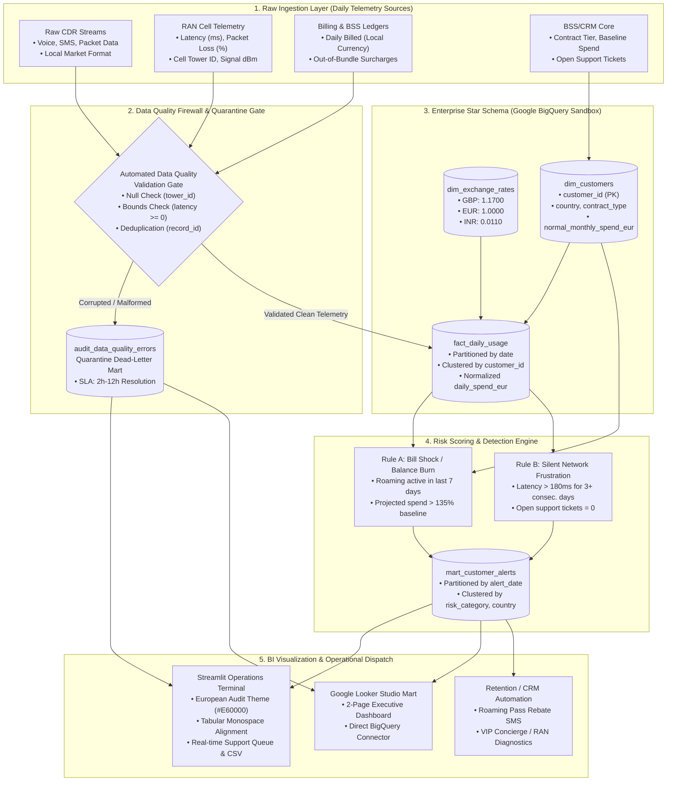
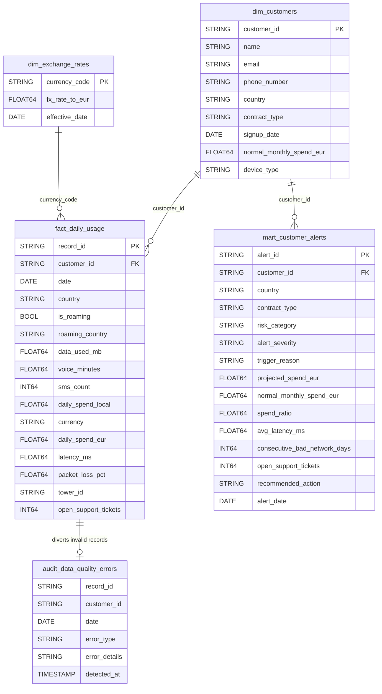
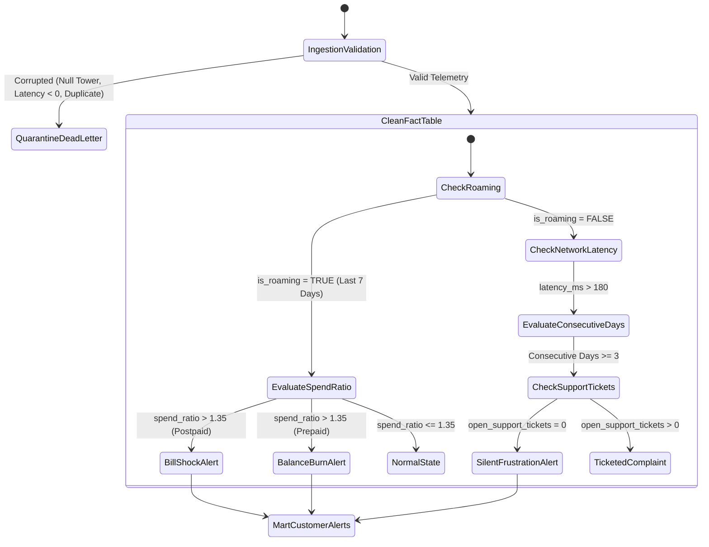

# TelecomGuard — Enterprise Architecture & Data Lineage Specification

**Vodafone Intelligent Solutions (VOIS) — Revenue Assurance, Churn Prevention & Data Governance**  
**Document Revision:** `v2.4-PROD` | **Classification:** `Restricted / Operations & BI Infrastructure`  
**Operating Markets:** `United Kingdom (UK)`, `Germany (DE)`, `India (IN)`

---

## 1. Executive Summary & Lineage Overview

TelecomGuard is an enterprise-grade telemetry ingestion, revenue assurance, and customer retention pipeline engineered for VOIS operating companies across the United Kingdom, Germany, and India. The platform ingests high-velocity daily Call Detail Records (CDRs), cellular radio network telemetry, and billing events, applies multi-currency Foreign Exchange (FX) normalization, enforces automated data quality quarantine firewalls, executes predictive risk classification algorithms, and serves high-density operational terminals and executive BI dashboards.

### End-to-End Enterprise Data Lineage



---

## 2. Multi-Country FX Normalization Standard

To eliminate currency distortion across Vodafone operating entities, all financial telemetry and risk metrics are normalized to **EUR (€)** at ingestion time using deterministic exchange rate multipliers:

$$\text{Spend}_{\text{EUR}} = \text{Spend}_{\text{Local}} \times \text{FX Rate to EUR}$$

| Operating Company (Market) | Local Currency | Pegged / Baseline FX Rate to EUR | Mathematical Implementation |
| :--- | :--- | :--- | :--- |
| **Vodafone UK (UK)** | `GBP` (£) | **`1.1700`** | `daily_spend_eur = daily_spend_local * 1.1700` |
| **Vodafone Germany (DE)** | `EUR` (€) | **`1.0000`** | `daily_spend_eur = daily_spend_local * 1.0000` |
| **Vodafone Idea (IN)** | `INR` (₹) | **`0.0110`** | `daily_spend_eur = daily_spend_local * 0.0110` |

---

## 3. BigQuery Star Schema & Data Dictionary

The data architecture adheres to an enterprise Star Schema optimized for high-throughput analytical querying and zero-billing execution within the Google BigQuery Sandbox ($0 tier).

### Entity Relationship Model



---

## 4. Exact Mathematical KPI Formulas

The terminal and Looker Studio BI reports surface four primary Key Performance Indicators (KPIs). All metrics are defined with strict algebraic formulations to ensure cross-system parity.

### KPI 1: Total Revenue at Risk (€)
The total monetary exposure representing the aggregate projected monthly revenue of accounts flagged under actionable risk conditions (Bill Shock, Balance Burn, and Silent Network Frustration):

$$\text{Total Revenue at Risk (EUR)} = \sum_{i \in \mathcal{A}_{\text{flagged}}} \text{Exposure}_i$$

Where individual exposure is calculated as:
$$\text{Exposure}_i = \begin{cases}
\max\left( \text{projected\_spend\_eur}_i - \text{normal\_monthly\_spend\_eur}_i, \; \text{projected\_spend\_eur}_i \right), & \text{if } \text{risk\_category}_i \in \{\text{'Bill Shock'}, \text{'Balance Burn'}\} \\
\text{normal\_monthly\_spend\_eur}_i, & \text{if } \text{risk\_category}_i = \text{'Silent Network Frustration'}
\end{cases}$$

### KPI 2: Bill Shock & Balance Burn Cases
The count of distinct subscribers whose 30-day projected billing exceeds the contract baseline spend threshold by more than 35% during or immediately following international roaming:

$$\text{Bill Shock Cases} = \sum_{i \in \mathcal{C}} \mathbb{I}\left( \text{is\_roaming}_i(T_{-7:T}) = \text{TRUE} \;\land\; \frac{\text{projected\_spend\_eur}_i}{\text{normal\_monthly\_spend\_eur}_i} > 1.35 \right)$$

*Where:*
- For **Postpaid**: Categorized as **Bill Shock Risk** (invoice dispute & write-off liability).
- For **Prepaid**: Categorized as **Balance Burn Risk** (rapid exhaustion leading to silent SIM dormancy).

### KPI 3: Silent Network Frustration Cases
Subscribers experiencing persistent Quality of Experience (QoE) degradation who have **zero logged support interactions**—identifying the highest-risk churn cohort:

$$\text{Silent Frustration Cases} = \sum_{i \in \mathcal{C}} \mathbb{I}\left( \left[ \bigwedge_{t=0}^{2} \left( \text{latency\_ms}_{i, T-t} > 180 \right) \right] \;\land\; \left( \text{open\_support\_tickets}_i = 0 \right) \right)$$

### KPI 4: Pipeline Data Quality Pass Rate (%)
The percentage of ingested raw records that satisfy all integrity, bounds, and referential constraints without entering the quarantine dead-letter partition:

$$\text{DQ Pass Rate (\%)} = \left( 1 - \frac{|\mathcal{R}_{\text{quarantine}}|}{|\mathcal{R}_{\text{raw}}|} \right) \times 100\% = \left( \frac{\sum \text{fact\_daily\_usage records}}{\sum \text{fact\_daily\_usage} + \sum \text{audit\_data\_quality\_errors}} \right) \times 100\%$$

---

## 5. Risk Detection Engines & Business Rules



### Operational Remediation Matrix

| Risk Classification | Target Segment | Trigger Condition | Recommended Operational Intervention | Target Resolution SLA |
| :--- | :--- | :--- | :--- | :--- |
| **Bill Shock Risk** | Postpaid (UK, DE) | Roaming in last 7 days + projected spend > 135% baseline | Auto-freeze dispute balance; apply retrospective Roaming Pass; dispatch proactive SMS alert with waiver guarantee. | < 4 hours from billing cycle |
| **Balance Burn Risk** | Prepaid (IN, DE) | Roaming/Data spike + projected spend > 135% baseline | Trigger automated low-balance push alert; apply 25% recharge bonus; offer localized prepaid booster bundle. | Real-time (< 30 minutes) |
| **Silent Frustration** | All Markets | Latency > 180ms for 3+ consecutive days + 0 support tickets | Push over-the-air (OTA) VoLTE network profile refresh; credit 15GB complimentary QoS buffer; dispatch local RAN cell inspection ticket. | < 12 hours |

---

## 6. BigQuery Sandbox ($0 Tier) Compliance Directives

To guarantee zero billing overhead while running across multi-gigabyte production-scale datasets, the analytical architecture strictly conforms to the following Google Cloud constraints:

1. **Idempotent DDL Transformations**: Zero use of DML (`UPDATE`, `DELETE`, `MERGE`). All pipeline transformations execute via deterministic:
   ```sql
   CREATE OR REPLACE TABLE `<project>.<dataset>.<table>` AS SELECT ...
   ```
2. **Partitioning Architecture**:
   - `fact_daily_usage` is partitioned daily on column `date` (`PARTITION BY date`).
   - `mart_customer_alerts` is partitioned on column `alert_date` (`PARTITION BY alert_date`).
3. **Clustering Strategy**:
   - `fact_daily_usage` is clustered by `customer_id` (`CLUSTER BY customer_id`).
   - `mart_customer_alerts` is clustered by `risk_category`, `country` (`CLUSTER BY risk_category, country`).
4. **Standard ANSI SQL Window Functions**: All trailing metrics utilize standard analytical windows (`AVG(...) OVER (PARTITION BY customer_id ORDER BY date ROWS BETWEEN 2 PRECEDING AND CURRENT ROW)`).

---

## 7. Data Governance & Regulatory Compliance (GDPR / Digital Personal Data Protection)

1. **MSISDN / Subscriber Pseudonymization**:
   - Under GDPR Article 32 and DPDP Act provisions, MSISDNs (`phone_number`) and IP addresses are masked or tokenized using HMAC-SHA256 salts rotated quarterly.
   - Operations terminals display surrogate keys (`customer_id`, e.g., `VF-UK-100234`) rather than raw cellular identifiers.
2. **Quarantine Dead-Letter Policy**:
   - Corrupted records (`audit_data_quality_errors`) are stored in an isolated, access-restricted dataset with a strict 30-day auto-purge TTL to prevent regulatory exposure.
3. **Audit Immutability**:
   - All alert records written to `mart_customer_alerts` maintain immutable audit timestamps (`alert_date`), ensuring full traceability for financial dispute reconciliation.
