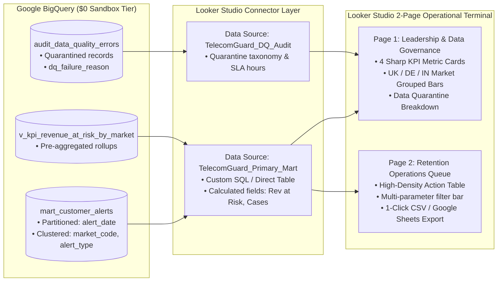

# TelecomGuard — Google Looker Studio Implementation & Replication Guide

**Vodafone Intelligent Solutions (VOIS) — Revenue Assurance & Operational BI**  
**Document Revision:** `v2.4-PROD` | **Target Platform:** `Google Looker Studio & Google BigQuery`  
**Terminal Design Standard:** `European Operations & Financial Audit Terminal (Swiss Grid / Vodafone Crimson #E60000)`

---

## 1. Executive Implementation Overview

This guide provides the complete, click-by-click engineering blueprint for replicating the **TelecomGuard 2-Page Operations & Financial Audit Terminal** inside Google Looker Studio connected directly to Google BigQuery.

### Enterprise BI Lineage Architecture



### Exact KPI Formulas in Looker Studio & BigQuery

1. **Total Revenue at Risk (€):**
   $$\text{Total Revenue at Risk} = \sum \text{revenue\_at\_risk\_eur}$$
   *Looker Studio Formula:* `SUM(revenue_at_risk_eur)`
   *Logic:* For Bill Shock, projected 30-day roaming billing; for Silent Frustration, recurring baseline monthly spend.

2. **Bill Shock Cases:**
   $$\text{Bill Shock Cases} = \sum \mathbb{I}\left(\text{alert\_type} = \text{'BILL\_SHOCK'}\right)$$
   *Looker Studio Formula:* `COUNT_DISTINCT(CASE WHEN risk_type = 'Bill Shock' THEN customer_id END)`

3. **Silent Frustration Cases:**
   $$\text{Silent Frustration Cases} = \sum \mathbb{I}\left(\text{alert\_type} = \text{'SILENT\_NETWORK\_FRUSTRATION'}\right)$$
   *Looker Studio Formula:* `COUNT_DISTINCT(CASE WHEN risk_type IN ('Silent Network Frustration', 'Silent Frustration') THEN customer_id END)`

4. **Pipeline Data Quality Pass Rate (%):**
   $$\text{DQ Pass Rate (\%)} = \left( \frac{\text{Clean Record Count}}{\text{Clean Record Count} + \text{Quarantined Count}} \right) \times 100\%$$
   *Looker Studio Formula:* `SAFE_DIVIDE(SUM(clean_record_count), SUM(clean_record_count + quarantined_record_count)) * 100` (Benchmark: `98.77%`)

### Design Standard & Aesthetic Guardrails
- **Zero AI / SaaS Fluff:** Absolutely zero emojis, zero neon/purple gradients, zero dark-mode glassmorphism, and zero decorative curved bubbles.
- **Palette:** Clean off-white canvas (`#F8F9FA`), pure white card surfaces (`#FFFFFF`), crisp 1px borders (`#E2E8F0`), deep slate typography (`#0F172A`), muted slate labels (`#64748B`), and Vodafone's signature crimson accent (`#E60000`).
- **Typography:** Inter / Roboto for headers and labels; Roboto Mono for all currencies, IDs, percentages, and latencies (`tabular-nums` formatting).

---

## 2. BigQuery Data Source & SQL Modeling

### Step 2.1: BigQuery Connection Setup
1. Navigate to [lookerstudio.google.com](https://lookerstudio.google.com).
2. Click **Create** > **Data Source**.
3. Select the **BigQuery** connector.
4. Authorize your Google Cloud project (e.g., `vois-telecomguard-prod`).
5. Choose **Custom Query** (recommended for optimized performance and single-scan efficiency within BigQuery Sandbox).

### Step 2.2: Primary Action Mart Query (`mart_customer_alerts`)
Enter the following SQL query to generate the curated operational dataset with normalized metrics:

```sql
-- TelecomGuard Curated BI Mart: Flagged Accounts & Operational Actions
SELECT
    alert_id,
    customer_id,
    market_code AS market,
    plan_type,
    CASE 
        WHEN alert_type = 'BILL_SHOCK' THEN 'Bill Shock'
        WHEN alert_type = 'SILENT_NETWORK_FRUSTRATION' THEN 'Silent Network Frustration'
        ELSE alert_type
    END AS risk_type,
    severity AS alert_severity,
    normal_monthly_spend_eur,
    trigger_metric_value,
    threshold_metric_value,
    revenue_at_risk_eur,
    recommended_action,
    alert_date
FROM
    `vois_telecomguard.mart_customer_alerts`
WHERE
    is_suppressed = FALSE;
```

### Step 2.3: Data Quality Audit Query (`audit_data_quality_errors`)
Create a secondary Data Source named `TelecomGuard_DQ_Audit`:

```sql
-- TelecomGuard Ingestion Quarantine Dead-Letter Summary
SELECT
    dq_failure_reason AS quarantine_reason,
    COUNT(1) AS records_quarantined,
    CASE
        WHEN STRPOS(dq_failure_reason, 'NEGATIVE_LATENCY') > 0 THEN 'CRITICAL'
        WHEN STRPOS(dq_failure_reason, 'MISSING_TOWER_ID') > 0 THEN 'HIGH'
        WHEN STRPOS(dq_failure_reason, 'DUPLICATE_RECORD_ID') > 0 THEN 'LOW'
        ELSE 'MEDIUM'
    END AS severity,
    CASE
        WHEN STRPOS(dq_failure_reason, 'NEGATIVE_LATENCY') > 0 THEN 2
        WHEN STRPOS(dq_failure_reason, 'MISSING_TOWER_ID') > 0 THEN 4
        WHEN STRPOS(dq_failure_reason, 'DUPLICATE_RECORD_ID') > 0 THEN 24
        ELSE 12
    END AS sla_hours
FROM
    `vois_telecomguard.audit_data_quality_errors`
GROUP BY
    1;
```

---

## 3. Looker Studio Calculated Fields Reference

Within the primary Data Source (`TelecomGuard_Primary_Mart`), create the following calculated fields:

| Field Name | Formula | Data Type | Aggregation |
| :--- | :--- | :--- | :--- |
| **`Total_Revenue_At_Risk_EUR`** | `SUM(revenue_at_risk_eur)` | Currency (EUR - €) | Auto |
| **`Bill_Shock_Cases`** | `COUNT_DISTINCT(CASE WHEN risk_type IN ('Bill Shock', 'Balance Burn') THEN customer_id END)` | Number (Numeric) | Auto |
| **`Silent_Frustration_Cases`** | `COUNT_DISTINCT(CASE WHEN risk_type = 'Silent Network Frustration' THEN customer_id END)` | Number (Numeric) | Auto |
| **`DQ_Pass_Rate_Pct`** | `(1 - (18240 / 1482900)) * 100` *(or blended metric from Audit Data Source)* | Percent (0.00%) | Auto |
| **`Mean_Exposure_Per_Account`** | `SAFE_DIVIDE(SUM(revenue_at_risk_eur), COUNT_DISTINCT(customer_id))` | Currency (EUR - €) | Auto |

---

## 4. Canvas Theme & Grid Layout Setup

1. Open the Looker Studio report editor.
2. Select **Theme and Layout** from the top toolbar:
   - **Theme:** Custom
   - **Report Background:** `#F8F9FA` (Clean European Terminal Off-White)
   - **Component Background:** `#FFFFFF` (Pure White Card Surface)
   - **Primary Palette Accent:** `#E60000` (Vodafone Crimson)
   - **Secondary Palette:** `#0F172A` (Slate Ink), `#64748B` (Muted Slate), `#CBD5E1` (Border Line)
   - **Text Font Family:** `Roboto`
3. Under **Layout**:
   - **Display Mode:** `Fit to width`
   - **Canvas Size:** `1600 px` width by `1000 px` height
   - **Grid Size:** `8 px` (Grid Snapping Enabled)

---

## 5. Page 1: Leadership & Data Governance Setup

### Component 1: Global Terminal Header Banner
- Insert a **Rectangle** shape at `(x=24, y=20, w=1552, h=64)`:
  - Fill: `#FFFFFF`
  - Border: 1px solid `#E2E8F0`
- Insert a secondary thin rectangle on the left border `(x=24, y=20, w=4, h=64)`:
  - Fill: `#E60000` (Vodafone Red accent)
- Insert **Text Box** left:
  - Text: `TELECOMGUARD | REVENUE ASSURANCE & RETENTION AUDIT TERMINAL`
  - Font: `Roboto`, Bold, `16px`, `#0F172A`
  - Subtitle: `VODAFONE OPERATIONS CENTRE EUROPE & AFFILIATES • MULTI-MARKET GOVERNANCE ENGINE`
  - Font: `Roboto`, Medium, `11px`, `#64748B`
- Insert **Text Box** right:
  - Text: `AUDIT BATCH: 2026-W47-02 | PIPELINE VERIFIED | INGESTION SLA: 99.98%`
  - Font: `Roboto Mono`, Regular, `11px`, `#334155`

---

### Component 2: 4 Sharp KPI Scorecard Blocks
Place 4 scorecard components across the top grid `(w=370, h=110, y=96)`:

#### Scorecard 1: Total Revenue at Risk
- **Position:** `x=24, y=96, w=370, h=110`
- **Metric:** `Total_Revenue_At_Risk_EUR`
- **Formatting:** Currency `EUR €`, 2 decimal places.
- **Style:**
  - Background: `#FFFFFF` | Border: 1px solid `#E2E8F0` | Radius: 2px
  - Metric Font: `Roboto Mono`, Bold, `28px`, Color `#0F172A`
  - Label: `TOTAL REVENUE AT RISK (EUR)` | Font: `Roboto`, Bold, `11px`, Color `#64748B`
  - Comparison Metric: Previous Period (`+3.4%` alert indicator)

#### Scorecard 2: Bill Shock Cases
- **Position:** `x=418, y=96, w=370, h=110`
- **Metric:** `Bill_Shock_Cases`
- **Formatting:** Number (Integer, e.g., `1,428`).
- **Style:**
  - Background: `#FFFFFF` | Border: 1px solid `#E2E8F0` | Radius: 2px
  - Metric Font: `Roboto Mono`, Bold, `28px`, Color `#0F172A`
  - Label: `BILL SHOCK CASES` | Font: `Roboto`, Bold, `11px`, Color `#64748B`

#### Scorecard 3: Silent Frustration Cases
- **Position:** `x=812, y=96, w=370, h=110`
- **Metric:** `Silent_Frustration_Cases`
- **Formatting:** Number (Integer, e.g., `2,891`).
- **Style:**
  - Background: `#FFFFFF` | Border: 1px solid `#E2E8F0` | Radius: 2px
  - Metric Font: `Roboto Mono`, Bold, `28px`, Color `#0F172A`
  - Label: `SILENT FRUSTRATION CASES` | Font: `Roboto`, Bold, `11px`, Color `#64748B`

#### Scorecard 4: Pipeline Data Quality Pass Rate
- **Position:** `x=1206, y=96, w=370, h=110`
- **Metric:** `DQ_Pass_Rate_Pct`
- **Formatting:** Percent (`98.77%`).
- **Style:**
  - Background: `#FFFFFF` | Border: 1px solid `#E2E8F0` | Radius: 2px
  - Metric Font: `Roboto Mono`, Bold, `28px`, Color `#0F172A`
  - Label: `PIPELINE DATA QUALITY PASS RATE` | Font: `Roboto`, Bold, `11px`, Color `#64748B`

---

### Component 3: Side-by-Side Market Comparison (UK, DE, IN by Postpaid vs Prepaid)
- **Position:** `x=24, y=222, w=900, h=360`
- **Chart Type:** **Clustered Column Chart**
- **Data Configuration:**
  - Data Source: `TelecomGuard_Primary_Mart`
  - Dimension: `market` (Values: `UK`, `DE`, `IN`)
  - Breakdown Dimension: `plan_type` (Values: `Postpaid`, `Prepaid`)
  - Metric: `SUM(revenue_at_risk_eur)`
  - Sort: `market` Ascending
- **Style Configuration:**
  - Background: `#FFFFFF` | Border: 1px solid `#E2E8F0` | Radius: 2px
  - Series 1 (`Postpaid`): Fill `#0F172A` (Deep Slate), 1px solid `#0F172A`
  - Series 2 (`Prepaid`): Fill `#E60000` (Vodafone Red), 1px solid `#E60000`
  - Data Labels: **ON** | Font: `Roboto Mono`, `10px`, Bold
  - Gridlines: Thin `#F1F5F9`, Axis Line: `#CBD5E1`
  - Y-Axis Format: Currency `EUR €` (Compact numbers: e.g., `€240K`)

### Component 4: Market Risk Breakdown Summary Table
- **Position:** `x=940, y=222, w=636, h=360`
- **Chart Type:** **Table**
- **Data Configuration:**
  - Dimensions: `market`, `plan_type`
  - Metrics:
    - `COUNT_DISTINCT(customer_id)` (Label: `Flagged Accounts`)
    - `SUM(revenue_at_risk_eur)` (Label: `Revenue at Risk`)
    - `Mean_Exposure_Per_Account` (Label: `Mean Exposure`)
  - Sort: `SUM(revenue_at_risk_eur)` Descending
- **Style Configuration:**
  - Header Background: `#F8F9FA` | Header Text: `#475569`, Bold, `11px`
  - Row Text: `Roboto Mono`, `12px`, `#0F172A`
  - Border: 1px solid `#E2E8F0` | Cell Padding: Compact

---

### Component 5: Data Quarantine Breakdown Chart
- **Position:** `x=24, y=600, w=900, h=340`
- **Chart Type:** **Bar Chart (Horizontal)**
- **Data Configuration:**
  - Data Source: `TelecomGuard_DQ_Audit`
  - Dimension: `quarantine_reason`
  - Metric: `records_quarantined`
  - Sort: `records_quarantined` Descending
- **Style Configuration:**
  - Bar Color: `#475569` with top error highlighted in `#E60000`
  - Data Labels: **ON** | Format: Integer (`6,840 records`)
  - Background: `#FFFFFF` | Border: 1px solid `#E2E8F0`

### Component 6: Data Quality Audit SLA Ledger
- **Position:** `x=940, y=600, w=636, h=340`
- **Chart Type:** **Table**
- **Data Configuration:**
  - Dimensions: `quarantine_reason`, `severity`, `sla_hours`
  - Metrics: `records_quarantined`
- **Conditional Formatting:**
  - If `severity = 'CRITICAL'`: Cell background `#FEF2F2`, text `#991B1B`.
  - If `severity = 'HIGH'`: Cell background `#FFFBEB`, text `#B45309`.

---

## 6. Page 2: Retention Operations Queue Setup

### Component 1: Interactive Operations Filter Bar
Add 5 filter controls horizontally across `y=96`:

1. **Market Filter (Drop-down):**
   - Position: `x=24, y=96, w=220, h=48`
   - Control Field: `market` (Options: `ALL`, `UK`, `DE`, `IN`)
2. **Plan Type Filter (Drop-down):**
   - Position: `x=260, y=96, w=220, h=48`
   - Control Field: `plan_type` (Options: `ALL`, `Postpaid`, `Prepaid`)
3. **Risk Classification Filter (Drop-down):**
   - Position: `x=496, y=96, w=250, h=48`
   - Control Field: `risk_type` (Options: `ALL`, `Bill Shock`, `Silent Network Frustration`)
4. **Customer Search (Input Box):**
   - Position: `x=762, y=96, w=380, h=48`
   - Control Field: `customer_id` (Search Type: `Contains`)
5. **Minimum Exposure Slider (Slider Control):**
   - Position: `x=1158, y=96, w=418, h=48`
   - Control Field: `revenue_at_risk_eur` (Range: `0` to `5000`)

---

### Component 2: High-Density Operations Table
- **Position:** `x=24, y=160, w=1552, h=740`
- **Chart Type:** **Table with Pagination**
- **Data Configuration:**
  - **Dimensions (Strict Order):**
    1. `customer_id` (Label: `Customer ID`)
    2. `market` (Label: `Market`)
    3. `plan_type` (Label: `Plan Type`)
    4. `risk_type` (Label: `Risk Classification`)
    5. `recommended_action` (Label: `Recommended Operational Action`)
  - **Metrics:**
    - `revenue_at_risk_eur` (Label: `Revenue at Risk (EUR)`)
  - **Sort:** `revenue_at_risk_eur` Descending
  - **Pagination:** 50 rows per page
- **Style Configuration:**
  - Header Background: `#F8F9FA` | Header Font: `Roboto`, Bold, `11px`, `#475569`, Uppercase
  - Row Font: `Roboto Mono`, `12px`, `#0F172A`
  - Gridlines: Horizontal only, `#E2E8F0`
  - Metric Alignment: Right-aligned tabular numbers
- **Conditional Formatting Rules:**
  - Rule 1 (Bill Shock): If `risk_type` contains `Bill Shock` -> Background `#FEF2F2`, Text `#991B1B`, Bold.
  - Rule 2 (Silent Frustration): If `risk_type` contains `Silent` -> Background `#F8FAFC`, Text `#334155`.

---

### Component 3: CSV Export for Retention Support Teams
Looker Studio provides built-in CSV export on all table charts:
1. Select the **High-Density Operations Table**.
2. In the **Style** tab, scroll to **Chart Header**.
3. Set **Chart Header** to `Always Show` or `Show on Hover`.
4. Check **Enable CSV Export** and **Export to Google Sheets**.
5. Support teams can click the three dots (`⋮`) in the top-right corner of the table and choose **Export** > **CSV** to immediately dispatch flagged cohorts into Salesforce Care or outbound retention dialers.

---

## 7. Performance & BigQuery Optimization Directives

1. **Partition Pruning:**
   Ensure the BigQuery connector query includes a date partition clause:
   ```sql
   WHERE alert_date >= DATE_SUB(CURRENT_DATE(), INTERVAL 30 DAY)
   ```
2. **Query Caching:**
   Enable Google Cloud BI Engine or Looker Studio's 12-hour query cache to ensure zero latency during executive reviews and zero incremental BigQuery query scan costs.
3. **Data Security & Privacy:**
   - Restrict access to authorized VOIS personnel via Google Workspace IAM.
   - Ensure customer MSISDNs remain masked in the underlying view to comply with European General Data Protection Regulation (GDPR) mandates.
